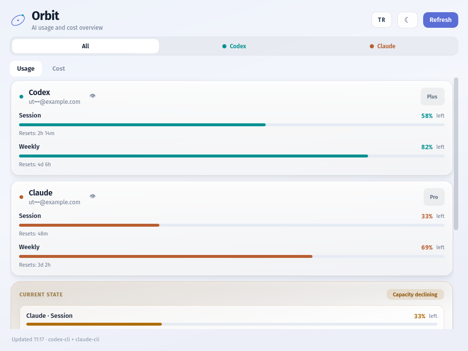

# Orbit

A standalone AI usage, cost and review dashboard for the Linux desktop. Orbit
reads the upstream [CodexBar](https://github.com/steipete/CodexBar) CLI and turns
its JSON into provider cards, reset counters, spend charts and a long-term token
history. It never stores credentials and never calls a provider API itself.



## Requirements

- Python 3.10+
- PyQt6 (`pip install -r requirements.txt`)
- The CodexBar CLI, version 0.54 or newer, on your `PATH`

## Run

```bash
git clone https://github.com/Utkucan-W/orbit-ai-usage-cost-review.git
cd orbit-ai-usage-cost-review
pip install -r requirements.txt
python3 app.py
```

Orbit looks for `codexbar-0540` and then `codexbar`, first in `~/.local/bin` and
then on your `PATH`. Point it somewhere else with:

```bash
python3 app.py --cli /path/to/codexbar
```

To see the interface without the CLI installed, run it against the bundled
fixture:

```bash
python3 app.py --fixture tests/fixtures/usage.json
```

## What it shows

- **Usage** — one card per connected provider: account, plan, remaining session
  and weekly capacity, and the reset time for each window.
- **Current state** — one line per provider, tightest window first, coloured by
  how much is left: green above 50%, amber from 50% down to 25%, red below that.
- **Cost** — current and 30-day spend, token totals, a daily cost chart and a
  per-model breakdown.
- **Token history** — daily `totalTokens` records kept on your device for up to
  365 days, so the monthly chart outlives the CLI's own reporting window.
- Turkish and English, light and dark theme, system tray icon, 60-second
  auto-refresh, and a single-instance guard so a second launch does not create a
  second tray icon.

## Privacy

Orbit is a viewer. It never asks for, stores or transmits provider credentials;
it only runs the CodexBar CLI you already have and reads its output. Account
addresses are masked in the interface until you reveal them. Preferences live in
`~/.config/Orbit/`, the token history in `~/.local/share/Orbit/`, and nothing
leaves the machine.

## Development

```bash
QT_QPA_PLATFORM=offscreen PYTHONPATH=. python3 tests/test_app.py
```

The application is a single `app.py`; `tests/test_app.py` covers parsing, state
bands, token-history merging and localisation. Engineering notes about upstream
CLI behaviour are in [docs/LEARNINGS.md](docs/LEARNINGS.md).

## Relationship to CodexBar

Orbit is an independent Linux frontend inspired by CodexBar and built on top of
its CLI. It is **not** affiliated with, endorsed by or maintained by the CodexBar
project. Install and update the CLI from upstream.

## License

MIT — see [LICENSE](LICENSE).
