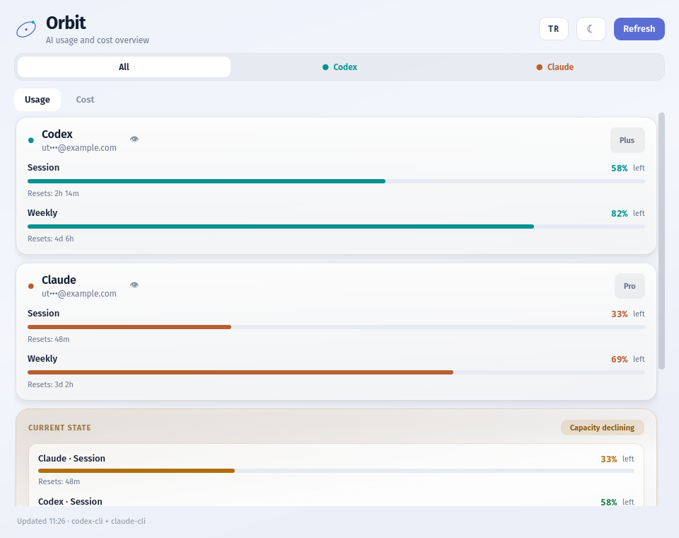
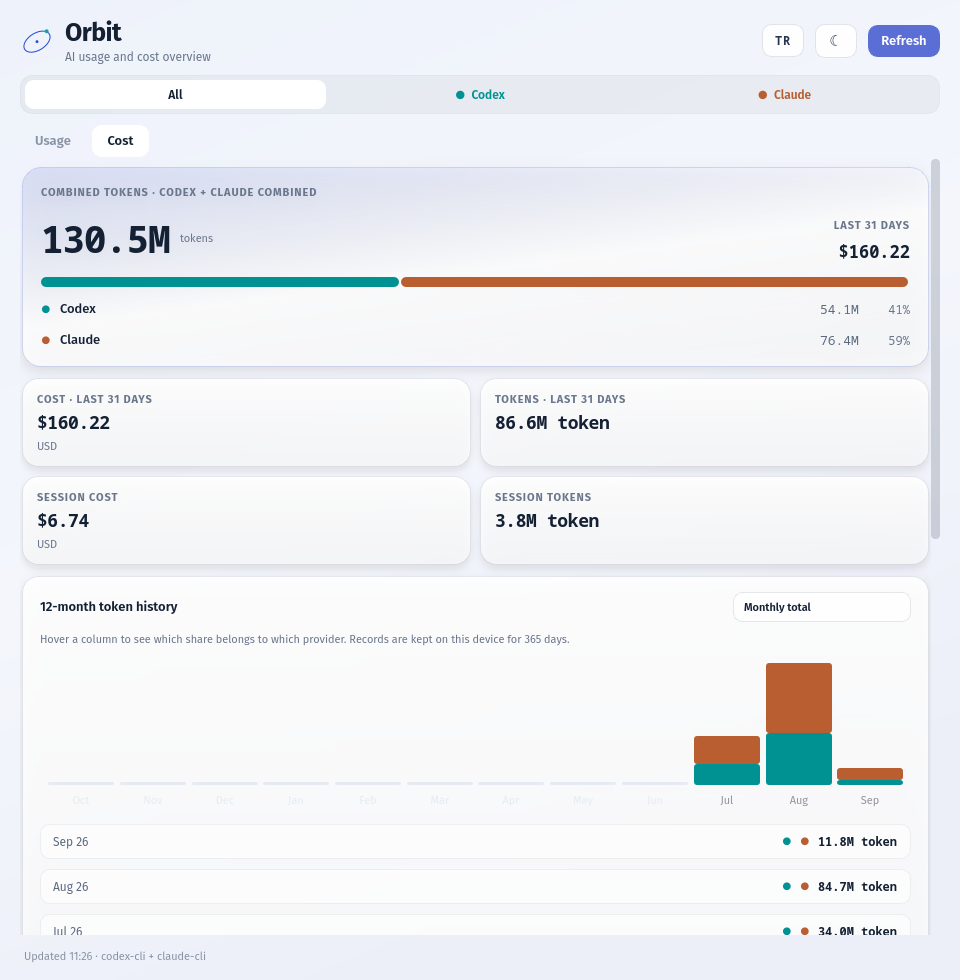
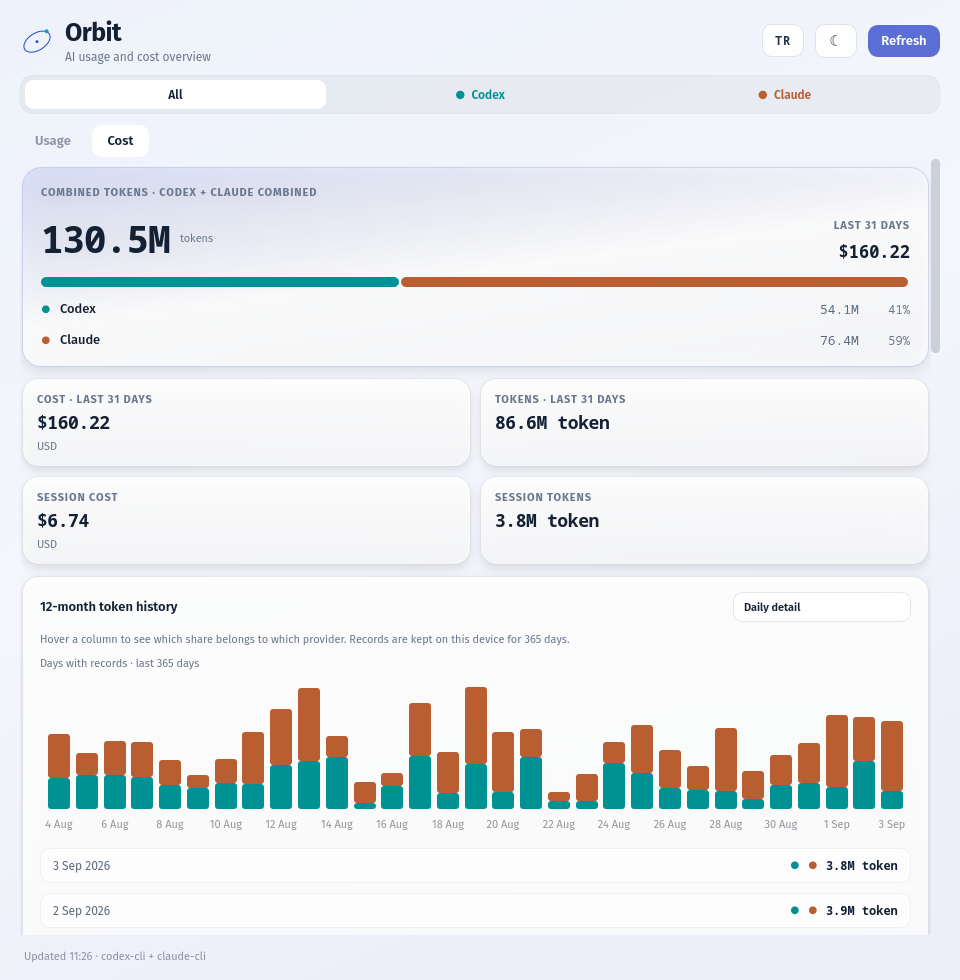
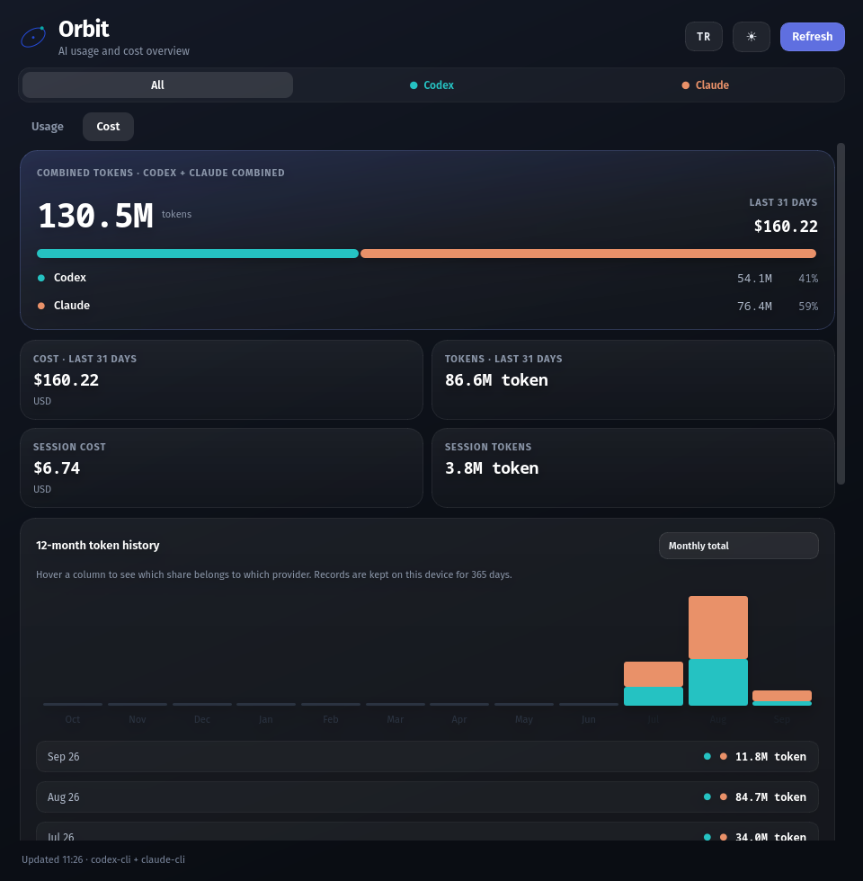
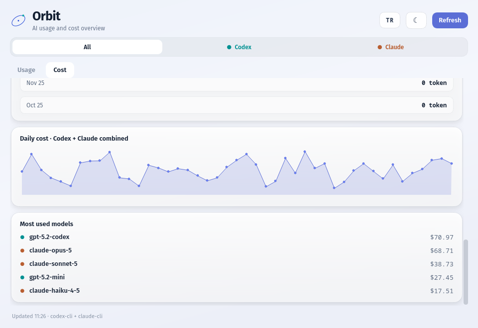

# Orbit

A standalone AI usage, cost and review dashboard for the Linux desktop. Orbit
reads the upstream [CodexBar](https://github.com/steipete/CodexBar) CLI and turns
its JSON into provider cards, reset counters, spend charts and a long-term token
history. It never stores credentials and never calls a provider API itself.



## Requirements

- Python 3.10+
- PyQt6 (`pip install -r requirements.txt`)
- The CodexBar CLI, version 0.54 or newer, on your `PATH`

## Run

```bash
git clone https://github.com/Utkucan-W/orbit-ai-usage-cost-review.git
cd orbit-ai-usage-cost-review
pip install -r requirements.txt
python3 app.py
```

Orbit checks `codexbar-0540` and `codexbar` in `~/.local/bin` and on your
`PATH`, then chooses the newest version that is at least 0.54. Point it
somewhere else with:

```bash
python3 app.py --cli /path/to/codexbar
```

To see the usage view without the CLI installed, run it against the bundled
fixture (the cost view stays empty — it needs real CLI output):

```bash
python3 app.py --fixture tests/fixtures/usage.json
```

## Screenshots

| Usage | Cost |
|---|---|
|  |  |
| Provider cards, remaining capacity per window, and the current-state card. | Combined tokens, spend tiles and the 12-month token history. |

| Daily detail | Dark theme |
|---|---|
|  |  |
| Every recorded day, with the daily cost sparkline and model spend below. | Every view follows the theme; the choice is remembered. |



All screenshots use sample data, not a real account.

## Features

**Scope.** A selector across the top switches between *All* and any single
provider the CLI reports. Every card, chart and total below it re-scopes with the
selection.

### Usage view

- One card per connected provider, colour-coded, showing the account address and
  the plan badge the CLI reports (Plus, Pro, connected account, API key).
- The address is masked (`ut•••@example.com`) until you press the eye button.
- One bar per usage window — session, weekly, whatever upstream exposes — with
  the percentage left and the exact reset time, localised from the absolute
  timestamp rather than the CLI's English phrasing.
- **Current state** card: one line per provider, tightest window first, coloured
  green above 50% left, amber from 50% down to 25%, red below that. The card
  itself takes the colour of its worst provider, and a sentence below says what
  to do about it. The method note is on the card's tooltip.

### Cost view

- **Combined tokens** hero: total tokens in the retained history, spend over the
  last 31 days, and a share bar with a legend line per provider.
- Four tiles: cost and tokens over the last 31 days, cost and tokens for the
  current session.
- **12-month token history** with a monthly/daily switch. Columns stack the
  providers; hovering one breaks down who spent what. Daily view charts the last
  31 days and lists every recorded day.
- **Daily cost** sparkline over the CLI's reporting window.
- **Most used models**: the top five by spend, dotted with their provider colour.

### Everywhere

- Turkish and English, switched from the header; the whole interface — including
  tab titles and the tray menu — is rebuilt so nothing is left in the old
  language.
- Light and dark theme; both the theme and the language survive a restart.
- System tray icon with open, refresh and quit; closing the window leaves Orbit
  running in the tray.
- Automatic refresh every 60 seconds, plus a manual Refresh button. Reads run on
  a background thread, so the window never freezes while the CLI is working.
- Each provider is read by name and shown as soon as it answers, instead of
  waiting for the slowest one. The full `--provider all` scan runs once per
  launch, only to notice a provider Orbit has not seen yet.
- **Codex** falls back to the local `codex app-server` when CodexBar cannot
  start it, and shows the free rate-limit reset credits and their nearest
  expiry. Orbit never reads credentials; the Codex CLI answers from its own
  login.
- **Compaction rate** under each client: the share of sessions active in the
  last 7 days that were compacted at least once, counted from the local
  transcripts in `~/.claude/projects` and `~/.codex/sessions`.
- A failed refresh keeps provider identity and historical costs visible, but
  marks current usage as unknown instead of treating cached percentages as live.
  Usage also becomes unknown after 45 minutes without a successful read, or
  when an absolute reset time has already passed.
- Token history is stored per day and per provider on your device for 365 days,
  so the monthly chart outlives the CLI's own reporting window.
- Only one instance runs: a second launch reports that Orbit is already running
  and exits instead of adding a second tray icon. Click the tray icon to bring
  the window back.

## Privacy

Orbit is a viewer. It never asks for, stores or transmits provider credentials;
it only runs the CodexBar CLI you already have and reads its output. Account
addresses are masked in the interface until you reveal them. Preferences live in
`~/.config/Orbit/`, the token history in `~/.local/share/Orbit/`, and nothing
leaves the machine.

## Development

```bash
QT_QPA_PLATFORM=offscreen PYTHONPATH=. python3 tests/test_app.py
```

The application is a single `app.py`; `tests/test_app.py` covers parsing, state
bands, token-history merging and localisation. Engineering notes about upstream
CLI behaviour are in [docs/LEARNINGS.md](docs/LEARNINGS.md).

## Relationship to CodexBar

Orbit is an independent Linux frontend inspired by CodexBar and built on top of
its CLI. It is **not** affiliated with, endorsed by or maintained by the CodexBar
project. Install and update the CLI from upstream.

## License

MIT — see [LICENSE](LICENSE).
